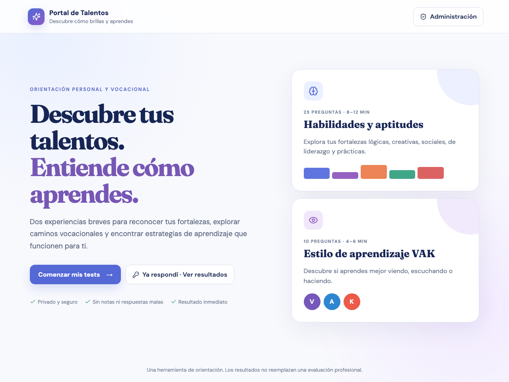
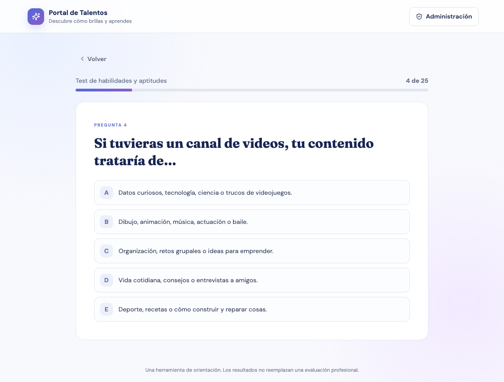
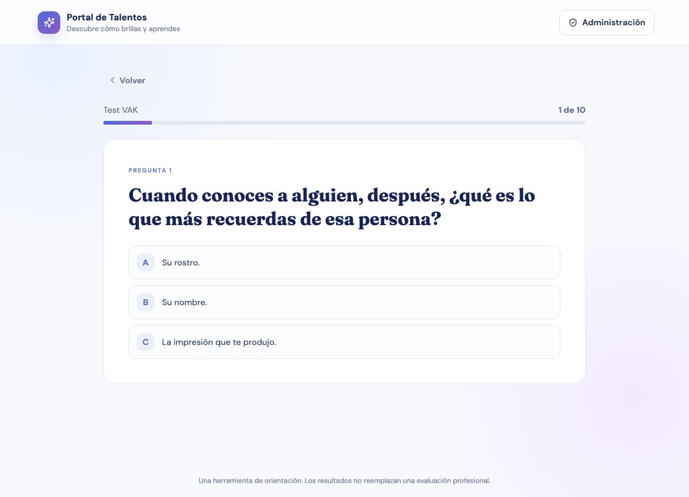
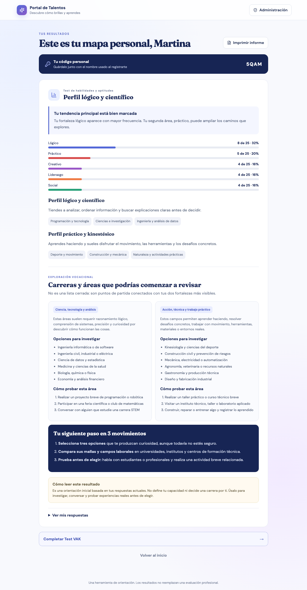
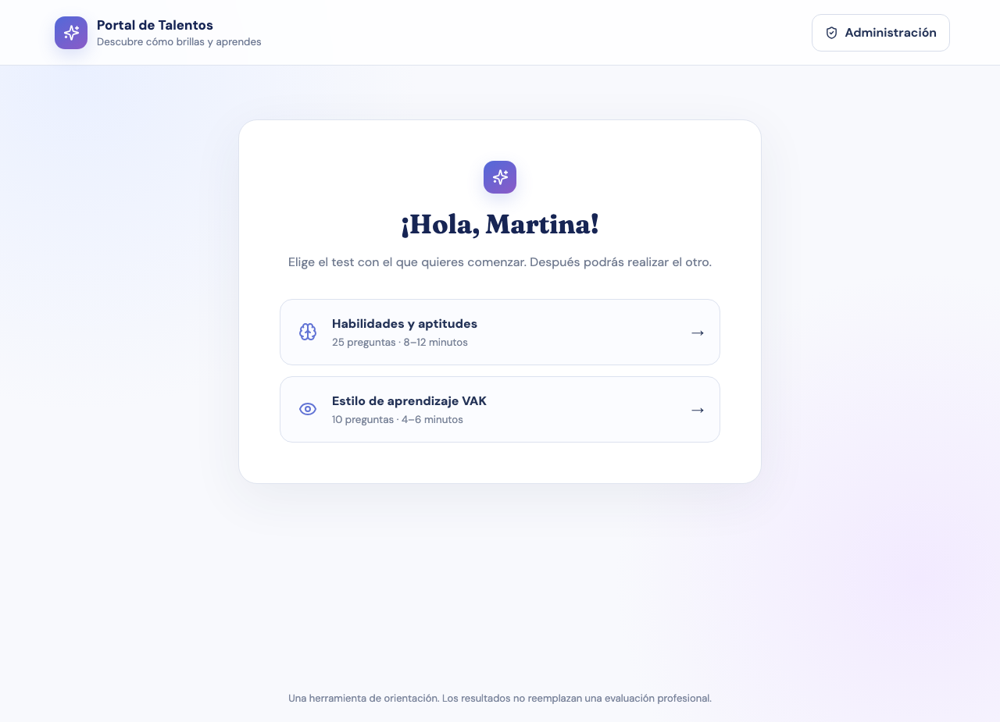
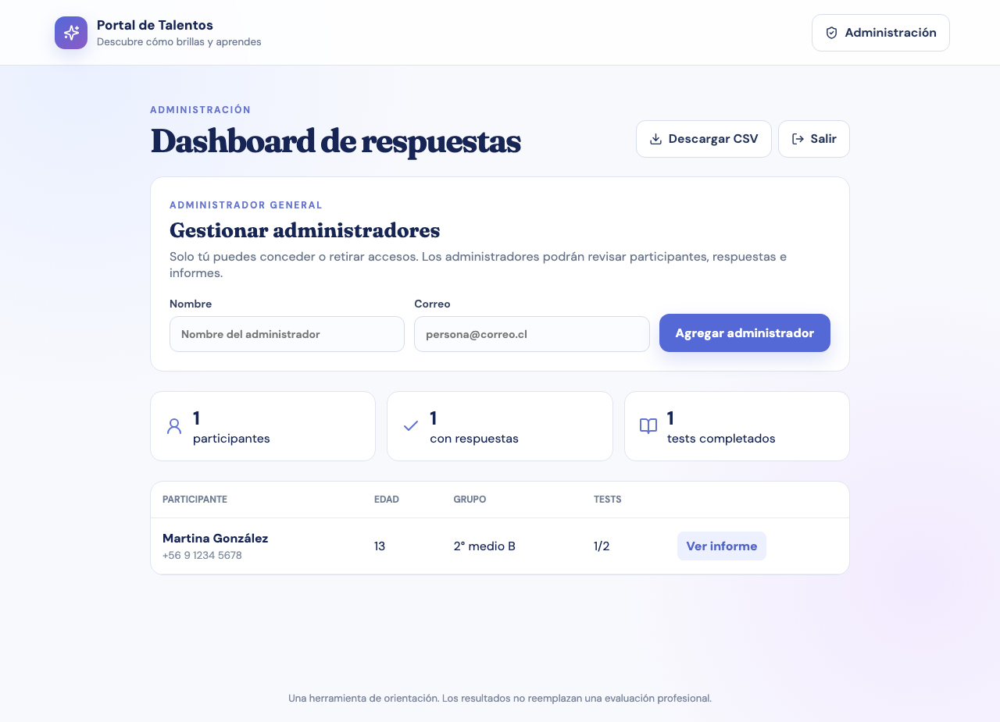

# Portal de Talentos y Aprendizaje

> **Evaluación open source de aptitudes y estilos de aprendizaje** para jóvenes de 10 a 15 años. Descubre fortalezas, explora caminos vocacionales y encuentra formas de aprender que funcionan para cada estudiante.

[][release]
[][license]
[](#)
[](#)
[](#)

Portal de Talentos es una herramienta de orientación personal y vocacional que combina dos **evaluaciones breves** con un motor de puntuación propio:

- **Habilidades y aptitudes** — 25 preguntas · 8–12 minutos. Detecta áreas lógicas, creativas, de liderazgo, sociales y prácticas.
- **Estilo de aprendizaje VAK** — 10 preguntas · 4–6 minutos. Identifica si el aprendizaje es visual, auditivo o kinestésico.

Los resultados generan **perfiles personalizados** con sugerencias de carreras, planes de estudio y actividades de prueba.

> ⚠️ **Aviso importante:** esta distribución **no está conectada** a ningún Firebase de producción y no contiene datos reales. Cada usuario configura la aplicación con **su propio proyecto Firebase**.

---

## Capturas

| Inicio | Cuestionario de aptitudes |
|--------|---------------------------|
|  |  |

| Cuestionario VAK | Resultados |
|------------------|------------|
|  |  |

| Registro del participante | Panel de administración |
|---------------------------|-------------------------|
|  |  |

> Capturas generadas con datos ficticios contra el **emulador local**. No contienen información personal real.

[release]: https://github.com/matiasgonzalovq/portal-talentos/releases/tag/v0.1.0
[license]: ./LICENSE

---

## Funcionalidades

- **Dos evaluaciones** (aptitudes y VAK) con motor de puntuación `scoreTest`.
- Registro de participante (nombre, edad, grupo, contacto opcional) y **código de recuperación** de 4 dígitos.
- Almacenamiento de resultados en Firestore bajo `participants/{id}/submissions/{testType}`.
- Consulta de resultados por código de acceso.
- Panel de administración (dashboard): lista de participantes, respuestas, informes y **exportación CSV**.
- Gestión de administradores mediante **custom claims** (`admin` y `superAdmin`) — **el correo electrónico no es criterio de autorización**.

## Arquitectura

- **Frontend**: Vite + React (versión 19)
- **Backend**: Firestore (NoSQL), Firebase Auth (autenticación)
- **Despliegue (opcional)**: Firebase Hosting
- **Build**: `npm run build`
- **Tests**: Vitest (unitarios + reglas Firestore) y Playwright (e2e)

### Flujo de datos

1. El estudiante accede y se registra (nombre, edad, grupo, contacto opcional).
2. Elige un test (aptitudes o VAK) y responde las preguntas.
3. `scoreTest` calcula los perfiles y resultados.
4. Los resultados se guardan en Firestore: `participants/{id}/submissions/{testType}`.
5. Un código de acceso (recoveryCode de 4 caracteres) permite volver a consultar los resultados.

### Flujo de administrador

1. Acceso mediante **Firebase Auth** con la custom claim `admin: true` en el token.
2. La claim `superAdmin: true` habilita la gestión de otros administradores y la eliminación de registros.
3. El panel muestra participantes, respuestas e informes.
4. Generación de CSV de resultados.
5. Eliminación segura de registros (con confirmación).

---

## Requisitos de instalación

- Node.js **20+** (se recomienda LTS)
- npm
- Una cuenta de **Google** para crear el proyecto Firebase
- Opcional: **Firebase CLI** para emuladores y despliegue

## 1. Crear un proyecto Firebase propio

1. Ve a [Firebase Console](https://console.firebase.google.com/) e inicia sesión con tu cuenta Google.
2. Crea un **nuevo proyecto** (o usa uno existente), por ejemplo `portal-talentos-miuser`.
3. En **Project settings** → *Your apps*, registra una **app Web** (`</>`). Copia el objeto `firebaseConfig` (contiene `apiKey`, `authDomain`, `projectId`, `storageBucket`, `messagingSenderId`, `appId`).

## 2. Activar Authentication y Firestore

1. En la consola, abre **Build → Authentication → Get started**. Habilita el proveedor **Email/Password**.
2. Abre **Build → Firestore Database → Create database**. Elige una ubicación y modo de producción.
3. (Recomendado) Activa los **Emuladores** para desarrollo local:
   ```bash
   npx firebase login
   npx firebase init
   npx firebase emulators:start
   ```
   El proyecto trae `firebase.json` con emuladores en los puertos 9160 (Firestore) y 9161 (Auth).

## 3. Configurar `.env.local`

1. Copia el archivo de ejemplo:
   ```bash
   cp .env.example .env.local
   ```
2. Rellena los valores con la configuración de **tu** proyecto Firebase:
   ```bash
   VITE_FIREBASE_API_KEY=tuApiKey
   VITE_FIREBASE_AUTH_DOMAIN=tuProyecto.firebaseapp.com
   VITE_FIREBASE_PROJECT_ID=tu-proyecto-id
   VITE_FIREBASE_STORAGE_BUCKET=tu-proyecto-id.firebasestorage.app
   VITE_FIREBASE_MESSAGING_SENDER_ID=tuSenderId
   VITE_FIREBASE_APP_ID=tuAppId
   ```
3. **Nunca** subas `.env.local` ni credenciales reales al repositorio. El `.gitignore` los excluye.

## 4. Ejecutar localmente

```bash
npm ci                 # instalar dependencias
npm run dev            # arrancar Vite (http://localhost:5173)
```

Para compilar y previsualizar:

```bash
npm run build
npm run preview        # sirve el build
```

## 5. Configurar administradores de forma segura

La autorización de administrador se basa en **custom claims** del token, no en el correo.

1. **Local / emuladores** — asigna la claim con el script (dry-run por defecto):
   ```bash
   FIREBASE_PROJECT_ID=<tu-proyecto-test> \
     node scripts/admin-claims.mjs --uid <UID_DEL_USER> --superadmin --apply
   ```
   El script exige confirmación explícita y **bloquea** proyectos no autorizados. La lista de proyectos permitidos se configura con `FIREBASE_ALLOWED_PROJECT_IDS=id1,id2`.

2. **Remoto** — consulta `scripts/DEPLOYMENT_GUIDE.md` y usa `scripts/admin-claims-remote.mjs`, que además requiere un **service account** real (no incluido). Siguiendo siempre el principio de dry-run + confirmación.

Después de asignar la claim, el administrador debe **cerrar sesión y volver a entrar** para que Firebase renueve el token.

> El script remoto **no** debe usarse con un service account de un proyecto de producción sin autorización explícita.

## 6. Desplegar (opcional) en Firebase Hosting

```bash
npx firebase login
npx firebase use <tu-proyecto-id>
npm run build
npx firebase deploy --only hosting
```

Revisa `scripts/DEPLOYMENT_GUIDE.md` para el procedimiento completo de despliegue seguro y rollback, incluido el **backup de las reglas remotas actuales** antes de publicarlas.

## Ejecutar pruebas

```bash
npm test                 # todas las pruebas
npm run test:rules       # solo pruebas de reglas Firestore (requiere emuladores)
npm run build            # compila
```

Las pruebas de reglas se ejecutan contra los **emuladores** con un proyecto ficticio (`portal-talentos-test`), sin conexión a ninguna base de datos real.

Descripción de las suites de pruebas:
- `tests/test-data.test.ts` — motor de puntuación y preguntas.
- `tests/firestore.rules.test.ts` — reglas de lectura/creación/borrado.
- `tests/privilege-matrix.test.ts` — matriz de permisos admin vs superAdmin.
- `tests/claims-auth.test.ts` — autorización por claims y detección de rol UI.
- `playwright-test/` — flujos e2e (requiere emuladores + preview).

## Reglas de seguridad (firestore.rules)

El proyecto incluye `firestore.rules` con **mínimo privilegio**:

- Acceso de administrador por **custom claims** (`admin: true`, `superAdmin: true`).
- Eliminación de participantes, respuestas y gestión de admins **solo superAdmin**.
- Lecturas administrativas para cualquier `admin`.
- Registro público de participantes mediante validación de estructura.

Revisa el archivo antes de desplegarlo en tu proyecto.

---

## Advertencias de privacidad (datos de menores)

Este proyecto está orientado a menores de 10–15 años. Al desplegarlo, usted es responsable de:

- Cumplir con las **leyes de protección de datos de menores** aplicables en su jurisdicción (p. ej. COPPA en EE. UU., RGPD en la UE) y obtener el consentimiento parental adecuado.
- **No recopilar más datos de los necesarios** ni vincular los resultados a identidades personales sin fines legítimos.
- Implementar medidas de seguridad de almacenamiento y acceso a los datos (reglas de Firestore, autenticación).
- Informar a los responsables sobre el uso y retención de los datos.

**Esta distribución no incluye ni recopila datos reales de estudiantes**; el manejo de datos es responsabilidad del administrador que despliegue la aplicación.

## Limitaciones del cuestionario VAK

El **test VAK** (visual, auditivo, kinestésico) es una **herramienta exploratoria**, no una evaluación diagnóstica:

- Los resultados son **orientaciones iniciales** basadas en las respuestas de un momento concreto; varían con el tiempo y el contexto.
- **No reemplazan** una evaluación psicológica, clínica o vocacional profesional.
- **No** deben usarse para etiquetar, limitar o excluir a un estudiante.
- Son un punto de partida para explorar estrategias de aprendizaje, no una verdad fija sobre la persona.

## Roadmap y versionado

Consulta [ROADMAP.md](./ROADMAP.md) para las líneas de trabajo planificadas: ampliación de la batería de evaluaciones, formato reutilizable de preguntas, constructor visual, gestión de organizaciones, informes, biblioteca comunitaria, IA opcional y privacidad/validación.

Versión publicada: **v0.1.0** ([ver release](https://github.com/matiasgonzalovq/portal-talentos/releases/tag/v0.1.0)).

## Licencia

MIT — ver [LICENSE](./LICENSE).

## Contribuciones

Las contribuciones son bienvenidas. Antes de abrir un PR:

1. No incluyas credenciales, secretos ni datos personales.
2. No conectes la app a bases de datos de producción.
3. Ejecuta `npm test` y `npm run build` y confirma que pasan.

## Sin datos personales en el código

No se incluyen perfiles de personas reales ni datos sensibles. El rango 10–15 años es una descripción del usuario objetivo, no un registro de personas.

## Preguntas frecuentes

- **¿Los resultados son diagnósticos clínicos?** No. Son orientaciones iniciales basadas en respuestas actuales.
- **¿Puedo guardar mis resultados?** Sí, con tu código personal de 4 dígitos puedes volver a consultarlos.
- **¿Puedo hacer los dos tests?** Sí. Tras completar uno, puedes elegir el otro sin volver a registrarte.
- **¿Necesito un proyecto Firebase propio?** Sí. Esta copia no está conectada a ningún Firebase; debes crear tu propio proyecto y configurarlo en `.env.local`.